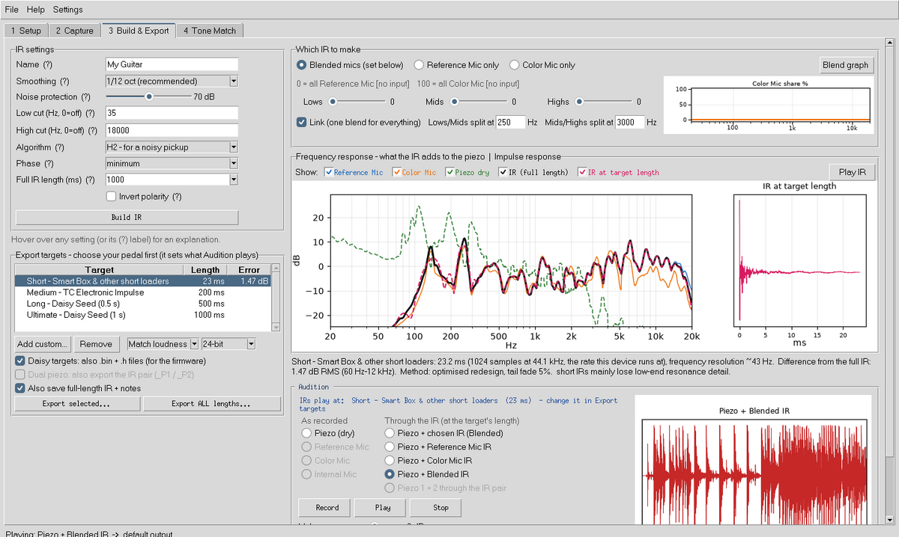

# Acoustic IR Studio

**Make your acoustic guitar's piezo sound like a microphone.**

Acoustic IR Studio records your pickup and a mic at the same time, works out exactly how they differ, and turns that into an impulse response (IR) for your IR pedal. It's a free app for Windows and Mac, and it doesn't need Reaper or any other DAW.

Created by **Paul McEvoy**: [paulmcevoyguitars.com](https://paulmcevoyguitars.com) · [Instagram](https://www.instagram.com/paulmcevoyguitars/) · [YouTube](https://www.youtube.com/@paulmcevoyguitars)
Thank you to [Vic Wong](https://www.paniquejazz.com/) for the inspiration.

## Download

**[⬇ Get the latest version](https://github.com/paulmcevoy75/acoustic-ir-studio/releases/latest)**, for Windows or Mac.

- **Windows:** download `AcousticIRStudio-windows.zip`, unzip it and run `AcousticIRStudio.exe`. If Windows says *"Windows protected your PC"* (the app isn't code-signed), click **More info → Run anyway**.
- **Mac:** download `AcousticIRStudio-mac-apple-silicon.zip` (M1 and later) or `…-mac-intel.zip` (older Macs) and unzip it. The first time, double-click the app, click **Done**, then go to **System Settings → Privacy & Security → Open Anyway** (the app isn't registered with Apple yet). Allow the microphone when asked.

## What it does

- **Guided capture.** Step-by-step playing prompts and a live coverage chart that shows which frequencies still need data and which notes to play. Every take is combined into one accurate IR.
- **Any mics.**
  - **Reference Mic:** a measurement mic with its calibration file, or anything you like.
  - **Color Mic (optional):** mix the two by frequency, e.g. lows from one, highs from the other.
  - **Internal Mic (optional):** the guitar's own mic.
- **USB mics just work.** A USB mic and an audio interface are clock-synced automatically.
- **IRs fitted to your pedal.** Four ready-made targets (Short, Medium, Long, Ultimate) plus your own. Each is optimised for that pedal's length, not just cut off.
- **Audition before you export.** Record a short demo and play it dry, through the mics, or through every IR at your pedal's length.
- **Tone Match.** Make an IR from single notes so your instrument sounds like any recording (audio or video file).
- **Dual piezo.** If your pickup has two elements, you can make an IR pair, one IR per element, for 2-input convolvers like a Daisy Seed.
- **Safe by design.** Everything is autosaved as you go, with crash recovery and a project file you can reopen and re-export.

## Quick start

1. **Setup:** pick your interface inputs for the piezo and the mic(s).
2. **Capture:** press **Start audio**, then follow the guided session (about 5–9 minutes).
3. **Build & Export:** press **Build IR**, choose your pedal, audition, then **Export**.

The [User Guide](docs/USER_GUIDE.md) covers every feature. Hover over any control in the app for an explanation.

## For pedal builders

IRs export as WAV, plus raw `.bin` and C header (`.h`) files for DIY firmware. The format is described in [docs/daisy-ir-format.md](docs/daisy-ir-format.md).

## Platform

Acoustic IR Studio runs on **Windows 10/11** and **macOS** (Apple Silicon and Intel). The in-app level slider for USB mics is Windows-only; on a Mac, set levels in Sound settings (there's a button for it). The automatic tests run on Windows, macOS and Linux for every change. Linux isn't a supported way to use the app, but the source runs there for development.

## For developers

Python 3.10+. Install with `pip install -r requirements.txt -r requirements-dev.txt`, start with `python acoustic_ir_studio.py`, and test with `pytest` (on Linux use `xvfb-run -a pytest`). The tests include the whole app running on a simulated sound card. [CONTRIBUTING.md](CONTRIBUTING.md) explains how the code is laid out.

## Help and feedback

Found a bug or have an idea? [Open an issue](https://github.com/paulmcevoy75/acoustic-ir-studio/issues). If something went wrong, attach `app.log` (in the app: **Help > Open logs folder**).

## Licence

Free and open source under the [GNU General Public License v3.0](LICENSE). You may use, study, change and share it under the GPL's terms. It comes with **no warranty**: start at a sensible volume when monitoring or playing test sounds. Third-party components are listed in [THIRD_PARTY_NOTICES.md](THIRD_PARTY_NOTICES.md).

© 2026 Paul McEvoy
